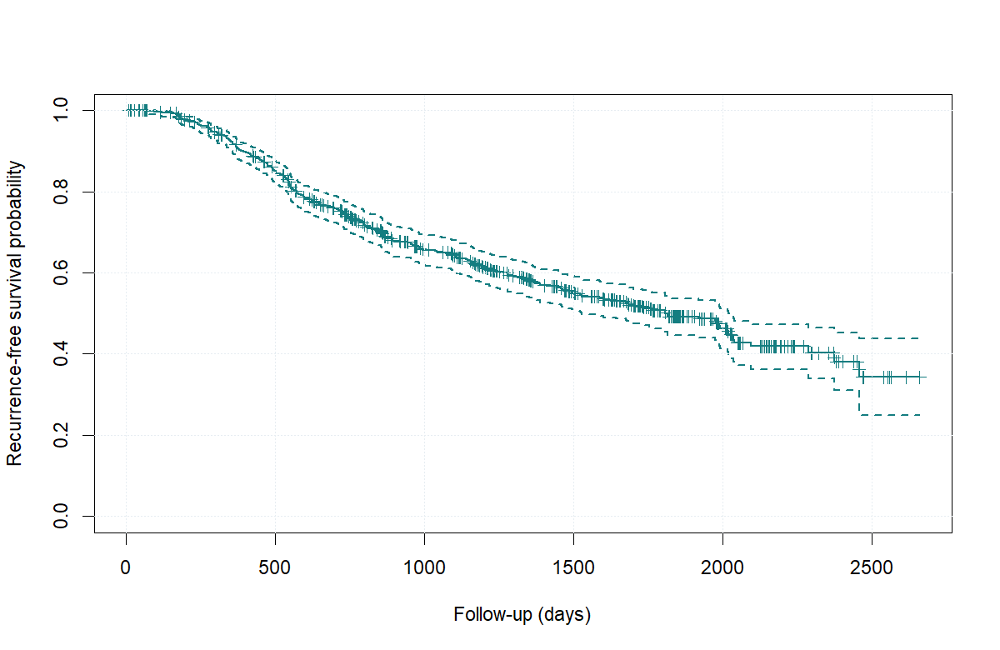
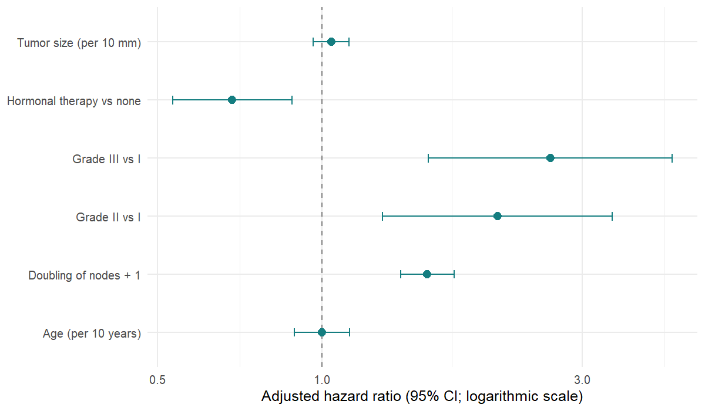
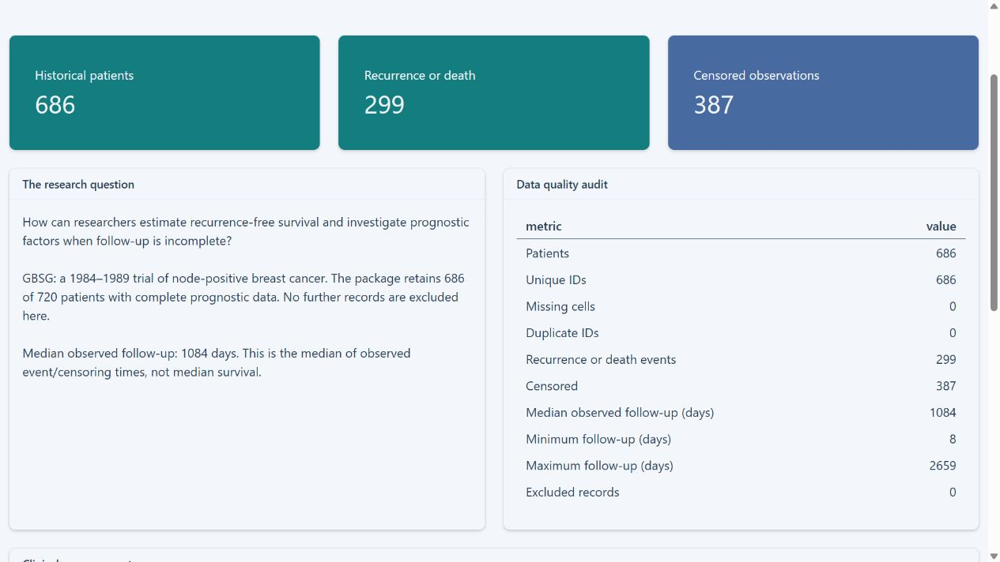

# SurvivalCare

**Clinical Survival Analysis & Prognostic Modeling** — Project 5 in Priynka Roy's data science portfolio.

An educational R Shiny application investigating how researchers estimate recurrence-free survival and examine prognostic factors when clinical follow-up is incomplete. It combines historical German breast cancer data with a reproducible Monte Carlo study of confidence interval reliability.

## Computed clinical findings

The installed `survival` 3.7-0 dataset contains **686 patients, 299 recurrence/death events and 387 censored observations**. The audit found no missing values or duplicate patient IDs and made no additional exclusions. Median observed event/censoring time is 1,084 days; it is not median survival.

| Follow-up | Kaplan–Meier survival | Log-log 95% CI | At risk |
|---|---:|---:|---:|
| 365 days | 0.9156 | 0.8917–0.9344 | 602 |
| 1,095 days | 0.6426 | 0.6033–0.6791 | 333 |
| 1,825 days | 0.4916 | 0.4458–0.5358 | 123 |



The prespecified Cox model includes age, size, grade, log2(nodes + 1) and hormonal therapy. Adjusted hazard ratios include grade III versus I **2.624 (1.568–4.393)**, doubling nodes + 1 **1.561 (1.395–1.748)** and hormonal therapy versus none **0.686 (0.533–0.882)**. These are descriptive associations, not causal treatment effects. **Proportional hazards is flagged globally (p=0.00215), for age and for grade.** Constant hazard ratios have limited interpretation. A grade-stratified sensitivity analysis leaves evidence of age non-PH (p=0.00715).



## Reliability study

Baseline: independent exponential event/censoring times, rates 0.1/0.05, n=100, evaluation time 5, B=2,000, seed 20261101, nominal 95%.

| Method | New coverage | MCSE | Mean width |
|---|---:|---:|---:|
| Direct normal | 0.9480 | 0.00496 | 0.2039 |
| Log-log | 0.9585 | 0.00446 | 0.2030 |

All baseline intervals were defined and supported. Realized censoring was 0.3345 versus theoretical 1/3. Fourteen further scenarios vary sample size, evaluation time and censoring intensity; results are in `artifacts/simulation_scenarios.csv`. No universal superiority follows from this limited experiment. Undefined intervals and unsupported follow-up are counted explicitly; normal limits are never silently clipped.

The original University of Turku *Asymptotical Methods in Statistics* coursework supplied the KM/Greenwood/exponential-simulation foundation. Its historical coverages 0.9450/0.9485 are user-provided historical results, not the new outputs. The original report/seed were not supplied. Clinical data, Cox diagnostics and the application are new work.

## Run and reproduce

Open `SurvivalCare.Rproj` in RStudio. In the project root:

```r
install.packages('renv') # only if unavailable
renv::restore()
source('tests/run_tests.R')
source('analysis/run_analysis.R')
source('analysis/run_simulations.R') # 30,000 replicates across baseline + scenarios
rmarkdown::render('reports/clinical_report.Rmd')
shiny::runApp()
```

Actual development R: **4.4.2 (Windows UCRT)**; see `renv.lock` and `artifacts/sessionInfo.txt` for resolved versions. Some Windows binaries were built under R 4.4.3 and emit patch-version warnings on 4.4.2. They loaded and the statistical checks passed; Linux CI remains to be verified remotely. No Python, database, keys, patient uploads or recurring data downloads are required at runtime.

## Application

Six sections: Clinical overview; Survival explorer; Prognostic factors; Model diagnostics; Statistical reliability lab; Methods & limitations. The explorer shows predefined groups, log-log bands, censoring marks, risk counts, endpoint support and untruncated interval comparisons. Simulation is explicit-button triggered, session cached, deterministic and capped at n=500/B=500 in the UI. Full research simulations are offline scripts.



## Project guide

- `R/`: audited data loading, statistical functions, plotting and simulations.
- `analysis/`: reproducible clinical and simulation pipelines.
- `artifacts/`: actual aggregate CSV outputs and figures; no patient-level export.
- `reports/clinical_report.Rmd`: executable HTML analytical report.
- `docs/`: data card, model protocol, limitations, interview guide, deployment and review.
- `tests/`: known-answer statistical checks and app initialization checks.
- `.github/workflows/ci.yml`: Windows/Linux reproducibility checks (remote status not yet verified).

## Provenance and limitations

`survival::gbsg` retains 686 complete-prognostic records from a 1984–1989 trial of 720 patients with node-positive breast cancer. Endpoint: days until first recurrence **or death**, otherwise last follow-up. It is neither overall survival nor recurrence alone. Historical care, complete-record selection, confounding, censoring assumptions and model misspecification restrict generalization. This is not a clinical decision tool or externally validated individual prediction model.

Original project code is MIT licensed. The dataset and package retain their upstream terms (`survival`: LGPL >=2); no patient dataset is re-licensed or bundled here. See [data card](docs/DATA_CARD.md).

References: [official dataset documentation](https://stat.ethz.ch/R-manual/R-devel/library/survival/html/gbsg.html); [Royston & Altman (2013), BMC Medical Research Methodology 13:33](https://doi.org/10.1186/1471-2288-13-33); [Posit Connect Cloud Shiny deployment](https://docs.posit.co/connect-cloud/how-to/r/shiny-r.html).

Target GitHub: [Priynka-Roy/Clinical-Survival-Analysis-and-Prognostic-Modeling](https://github.com/Priynka-Roy/Clinical-Survival-Analysis-and-Prognostic-Modeling). This is a target, not a claim of publication. Live app URL: **not deployed**. Current status: [delivery record](docs/STATUS.md).
